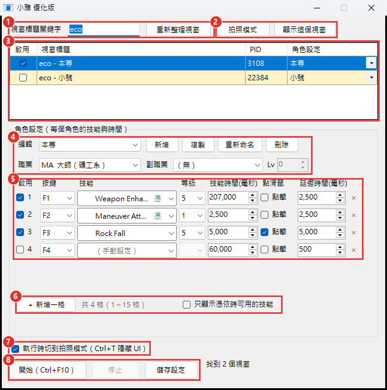
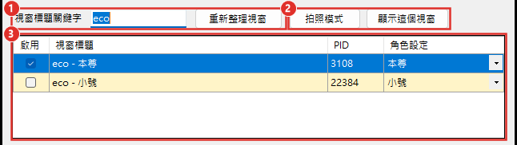
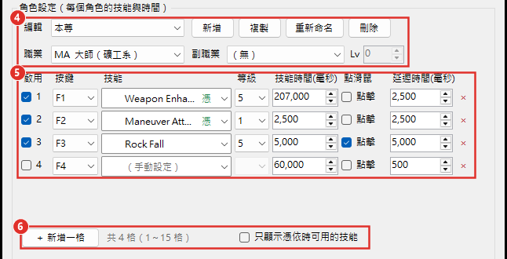
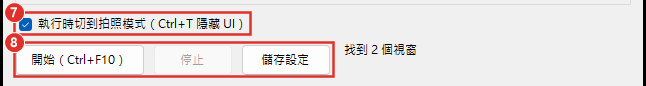

# 小雅 優化版（XiaoYaOpt）

ECO 自動技能按鍵工具「小雅」的重寫優化版。主要目的是解決原版**多開遊戲時 CPU 使用率過高**的問題。

> ⚠️ 在線上遊戲中使用自動按鍵工具，可能違反遊戲的使用條款並導致帳號被處分，請自行評估風險。

## 下載與執行

1. 到本 repo 的 **Releases** 下載最新的 `XiaoYaOpt-<版本>.zip`，解壓縮到任意資料夾。
2. 先開啟遊戲，再執行 `XiaoYaOpt.exe`（不需要安裝，Windows 內建的 .NET Framework 4 即可執行）。
   - 小雅會從執行中的遊戲自動找到遊戲資料夾，**技能名稱、技能圖示、副職業表都從你的遊戲資料夾讀取**；有裝技能中文化的話就會顯示中文。
   - 沒開遊戲就啟動時，技能名稱會先顯示英文；之後開遊戲再重開小雅即可（選副職業時也可以手動指定遊戲資料夾）。
3. `技能時間表.csv` 要和 `XiaoYaOpt.exe` 放在同一個資料夾。設定會存在同一個資料夾的 `小雅優化版.cfg` 與 `角色設定\`，升級時保留這兩個即可。

## 圖文教學

> 截圖是用示範設定與假的遊戲視窗拍的（沒有讀取遊戲資料夾，所以技能名稱顯示英文、沒有圖示）。實際使用時會顯示你遊戲裡的技能名稱與圖示。



| 編號 | 區塊 | 用途 |
|---|---|---|
| ① | 視窗標題關鍵字／重新整理視窗 | 找出標題含有關鍵字（預設 `eco`）的遊戲視窗 |
| ② | 拍照模式／顯示這個視窗 | 分辨清單裡的每一列是哪個遊戲視窗 |
| ③ | 視窗清單 | 勾選要自動按鍵的視窗，並替每個視窗選一個角色設定 |
| ④ | 角色設定 | 建立、切換每個角色的技能組，選主職業與副職業 |
| ⑤ | 技能格 | 每一格一個按鍵：技能、等級、技能時間、要不要點滑鼠、延遲時間 |
| ⑥ | 新增一格／憑依篩選 | 增加技能格；只列出憑依時可用的技能 |
| ⑦ | 執行時切到拍照模式 | 開始時隱藏遊戲 UI，停止時切回 |
| ⑧ | 開始／停止／儲存設定 | 開始或停止自動按鍵（快捷鍵 Ctrl+F10） |

### 步驟 1：找到遊戲視窗，分辨哪一個是哪一個（①②③）



1. 開啟遊戲（可多開），執行 `XiaoYaOpt.exe`，按 **①「重新整理視窗」**。標題含有關鍵字的視窗都會列在 **③** 清單裡。
2. 遊戲視窗的標題都是「eco」，多開時看不出哪一列是哪個角色。在清單點一下某一列，再用 **②** 的按鈕分辨：
   - **顯示這個視窗**：把那個遊戲視窗拉到最上層（縮小中會先還原）。視窗疊在一起時，跳到最上面的就是這一列。**在清單上雙擊一列**也可以。
   - **拍照模式**：對那個視窗送一次 Ctrl+T，遊戲 UI 會消失，消失的就是這一列；再按一次切回來。切在拍照模式的那一列會變成**黃色**（上圖第二列）。按「開始」時，黃色的視窗不會再被切一次。
   - 如果你在遊戲裡自己按了 Ctrl+T，小雅不會知道，黃色標記就會和實際相反，對那一列再按一次「拍照模式」即可。
3. 在「啟用」欄**勾選**要自動按鍵的視窗，在「角色設定」欄替每個視窗選一個角色設定。
   - 選了角色設定後，小雅會把那個遊戲視窗的標題改成「eco - 角色設定名稱」（例如「eco - 本尊」），工作列與 Alt+Tab 也看得到；選回「預設」就恢復原標題。
   - 小雅重開時，只要遊戲還開著，就會從標題自動認回每個視窗的角色設定。遊戲重開後標題會變回「eco」，需要重新指定。

### 步驟 2：建立角色設定與技能（④⑤⑥）



1. **④** 按「新增」，替角色取個名字（數量沒有上限，存在 exe 旁的 `角色設定\` 資料夾）。也可以「複製」現有的設定再修改。
2. **④** 選擇**職業**，每一格的「技能」下拉就只會列出該職業的技能（依習得職業等級排序）。
   - 主職業以職業線為單位，用最終職業的縮寫表示（GL、GU、ER、HAW、FO、AS、CA、SO、MA、HA、ST、RO，另有 JO、BR、GA），技能清單包含整條線（基本→進階→技術→最終職業）的技能。
   - 有副職業的角色再選**副職業**（遊戲的副職業是整個體系，例如「礦工系」= 礦工／鐵匠／工程師／大師），並可填 **Lv**（副職業等級，0 = 不限）。副職業的技能接在後面、前面標示「［副］」，只列出副職業真的學得到的技能，等級上限也照遊戲規定（從遊戲資料夾的 `data\xls\table.dat` 讀取，第一次選副職業時可能會請你指定遊戲資料夾）。
   - 職業選單最後的「**特殊技能**」：不屬於任何職業，靠裝備、夥伴、憑依傀儡、特定地圖或師徒關係取得的技能（大多沒有時間資料，選了之後要自己填時間）。
   - 被動技能不能按鍵施放，不會出現在清單中。
3. **⑤** 每一格設定一個技能：
   - **按鍵**：要和遊戲快捷列上的位置一致。
   - **技能**與**等級**：選好後，技能時間和延遲時間會自動帶入（預設最高等級）。選「（手動設定）」時不對應任何技能，按鍵與時間完全自己填（例如放道具）。
   - **技能時間**：同一個技能每隔幾毫秒按一次（最小 50 ms）。自動帶入的值：增益技能 = 持續時間 − 3 秒（效果快結束時再放）；其他技能 = 延遲時間。
   - **點擊**：按完技能後，在遊戲視窗正中央點一下滑鼠左鍵（原版的「鼠標」），給需要指定地點或目標的技能用。
   - **延遲時間**：按完技能（和點擊）後要等多久，這段時間內同一個視窗的其他技能會順延。自動帶入的值：詠唱時間 + 冷卻時間 + 0.5 秒。
   - 查不到資料、或增益技能官網沒有持續時間的，技能時間欄會變成**黃色**且**不自動啟用**，避免開關型技能（例如隱身）被一直切換；請確認時間後再勾選。
   - 最左邊的勾選框決定這一格要不要施放；右邊的「✕」刪除這一格。
4. **⑥** 按「＋ 新增一格」增加技能格（**1～15 格**，按鍵自動帶入還沒用過的 F1～F12，用完接著 1～9、0）。
   - **只顯示憑依時可用的技能**：清單只列憑依時可用的技能（右側標示綠色「憑」；已選的技能不會被清除）。這是**推估**：增益、治療、輔助類算可用，攻擊、減益、製作、召喚等算不可用。不準時在技能欄**按右鍵**標記「憑依時可用／不可用」或「恢復自動判斷」；手動標記顯示為「憑＊」，所有角色設定共用並會記住。
   - 換主職業或副職業時只會換掉下拉清單，已選的技能都會保留。

### 步驟 3：開始（⑦⑧）



1. **⑦ 執行時切到拍照模式**（預設開啟）：ECO 的 Ctrl+T 會切換拍照模式並隱藏遊戲 UI，這樣點視窗中央時才不會點到介面。開始時切入、停止時自動切回（和原版相同）。Ctrl 是模擬實體按鍵，按下的那一瞬間也會影響目前在前景的程式。
2. **⑧** 按「開始」或 **Ctrl+F10** 開始；按「停止」或再按一次 Ctrl+F10 停止。右邊會顯示正在執行的視窗數與已送出的按鍵次數。
3. 按鍵與點擊都是背景送出，不會搶走焦點，可以一邊做別的事。

### 技能施放的順序

- 每一格技能各自計時，時間到了就放，不是照 F1→F2→F3 輪流。
- 同一個視窗一次只放一個技能：放完後會等「延遲時間」，這段時間內其他到時間的技能會順延，等結束再依序放出。
- 不同視窗之間互不影響；剛開始時每個視窗的第一次施放會錯開 50 ms。

### 注意事項與常見問題

- **點擊沒有效果**：遊戲只在實體游標位於遊戲視窗範圍內時，才採用背景送來的點擊位置。請讓有勾「點擊」的遊戲視窗疊在一起、不要縮小，並把滑鼠游標停在遊戲視窗上。
- **游標偶爾跳到螢幕左上角**：這是遊戲自己在指定地點技能收到點擊時移動游標（eco.exe 內呼叫 `SetCursorPos`），不是小雅移動的。這段程式沒有檢查算出來的位置，推測是遊戲視窗縮小時位置算到螢幕外，游標才會被夾到左上角；有勾「點擊」的視窗建議不要縮小。

## 跟原版的差異

| 項目 | 原版 `小雅.exe`（易語言） | 優化版 |
|---|---|---|
| 尋找遊戲視窗 | 把視窗代碼 1～6,000,000 **逐一**呼叫 `IsWindow` + 取標題 | `EnumWindows` 一次列出所有頂層視窗 |
| 等待下一次按鍵 | 忙碌迴圈 | 單一排程執行緒，睡到下一個工作到期才醒來 |
| 多開 | 一次選一個「遊戲編號」，所有視窗共用一組技能 | 可同時勾選多個視窗，**每個視窗各自套用一個角色設定**，並自動錯開時間 |
| 分辨視窗 | — | 「顯示這個視窗」／雙擊把視窗拉到最上層、「拍照模式」按鈕單獨切換一個視窗、標題改成「eco - 角色設定」 |
| 技能設定 | 手動填寫 | 依職業從下拉選技能，依技能表自動填入中文名稱與建議時間 |
| 技能鍵送出 | 背景 `SendMessage`（要等遊戲處理完） | 背景 `SendMessageTimeout`（同樣等遊戲處理完，但最多等 0.5 秒，一個遊戲卡住不會拖住其他視窗） |
| 滑鼠點擊 | 背景 `PostMessage`：移動 → 按下 → 30ms → 移動 → 放開，點視窗正中央，不動實體游標 | 相同，但放開技能鍵後等 150 ms 才點、按住 100 ms（太早或太短時遊戲會認不到） |
| 拍照模式（Ctrl+T） | 開始時切入、停止時切回（Ctrl 用 `keybd_event`，T 用 `PostMessage`） | 相同，可關閉；中途關掉的視窗不會再送；已用按鈕切入的視窗不會重複切 |
| 停止時 | — | 補送所有還沒送出的「放開」，避免按鍵卡住 |
| 視窗被關掉 | — | 自動從排程移除；全部關掉時自動停止 |
| 開始／停止 | 按鈕 | 按鈕，或全域快捷鍵 **Ctrl+F10** |
| 設定檔 | `小雅身体配置.ini`（GBK） | `小雅優化版.cfg`（UTF-8，與 exe 同目錄） |

實測（假遊戲視窗，跑真正的訊息迴圈）：

- 8 個視窗 × 6 個技能、每 500 ms 一次、跑 12 秒：送出 1151 次按下／1151 次放開（理論值 1152），點擊 192 次，位置是視窗正中央；整個測試程序（含 8 個假視窗）只用單核 0.6～0.8% 的 CPU。
- 延遲時間 200 ms：同一個視窗兩次按鍵的最短間隔是 231～234 ms（按住 30 ms＋延遲 200 ms），技能有正確順延。
- 遊戲視窗全部關閉後，排程會自動停止。

## 建置

不需要安裝任何 SDK，Windows 內建的 .NET Framework 4 編譯器就夠了：

```powershell
powershell -ExecutionPolicy Bypass -File .\build.ps1
```

輸出：`bin\XiaoYaOpt.exe`（`data\技能時間表.csv` 會一起複製到 `bin\`）。若 `assets\app.ico` 存在（只在本機，不在 repo），會內嵌成程式圖示。

打包發布用的 zip（`XiaoYaOpt.exe` + `技能時間表.csv` + `README.md`）：

```powershell
powershell -ExecutionPolicy Bypass -File .\release.ps1 -Version 1.0.0
```

輸出：`dist\XiaoYaOpt-1.0.0.zip`

## 遊戲資料表解壓工具

`bin\XlsExtract.exe` 可以把遊戲的 `.hed/.dat` 封包解開（格式見 [`docs/analysis.md`](docs/analysis.md) 第 6 節）：

```powershell
.\bin\XlsExtract.exe "<遊戲資料夾>\data\xls\table.hed" <輸出資料夾> [只解這個檔名]
```

`table.hed` 內含 183 張 Shift-JIS 的 CSV 資料表（技能、道具、副職業…）。解出的內容是遊戲資料，請勿散佈。

## 技能時間表

`data\技能時間表.csv`（隨程式發布）只含官網的資料：技能 ID、等級、官網英文名、日文名稱、類型、詠唱／冷卻／持續時間、職業、習得職業等級、憑依時可否使用，**不含遊戲檔案的文字**（技能名稱、說明、客戶端 MP/SP）與其他玩家的中文化翻譯。技能名稱由小雅執行時從使用者自己的遊戲資料夾（`data\effect\effect.ssp`）讀取。

小雅會依序在以下位置尋找技能表：exe 同目錄的 `技能時間表.csv` → exe 同目錄的 `技能表.csv`（本機自己產生的完整技能表）→ `..\data\技能時間表.csv`。角色設定裡的技能以英文名（特殊技能為日文名）+ 等級查詢時間。

### 更新技能時間表（維護者用）

一般使用者不需要做這些。官網資料有更新時，維護者先產生本機的完整技能表，再精簡成發布用的版本：

```powershell
.\bin\SkillMerge.exe --publish <完整的 技能表.csv> .\data\技能時間表.csv
```

完整技能表由 `bin\SkillMerge.exe`（原始碼 `tools\SkillMerge.cs`）把遊戲的技能檔和官網技能說明整合而成（含遊戲資料，**不要上傳**）：

```powershell
.\bin\SkillMerge.exe <遊戲\data\effect\effect.ssp> <中文化的 effect.ssp> <遊戲\lang\jp\data\effect\effect.ssp> <官網HTML資料夾> <輸出的 技能表.csv> [特殊技能.csv]
```

官網 HTML 要先下載到一個資料夾，每個職業一個 `<職業>.html`，網址是 `https://eco.nekogame.com/wiki/<職業>-skill-explanation`（職業代號見 `src\Jobs.cs`）。
沒有官網資料的技能（多半是怪物技能、系統技能）只會有客戶端欄位。輸出含遊戲資料，請勿上傳或散佈。

第一個參數必須是**原版**（未中文化）的 `effect.ssp`，「原文名稱」欄（英文名，用來對應快捷列）才會正確；遊戲資料夾已經換成中文化技能檔時，請改用補入模式。

**特殊技能**（`特殊技能.csv`，放在 `bin\`）：UTF-8，欄位 `日文名稱,取得方式,詠唱時間(秒),冷卻時間(秒),持續時間(秒),目標,憑依`（憑依填 ○／×／空白）。依日文名稱對應技能 ID（同名多個時取最小 ID），職業欄加上 `special`，並補上「憑依時使用」欄。也可以只把特殊技能補進既有的技能表：

```powershell
.\bin\SkillMerge.exe --special <既有的 技能表.csv> <特殊技能.csv> <輸出的 技能表.csv>
```

## 與原版行為的對照說明

每個欄位的行為都是照原程式反組譯的結果實作，詳細過程見 [`docs/analysis.md`](docs/analysis.md)。原版的單次施放流程（`FUN_00402f45`）：

```
技能鍵按下 → 30ms → 放開 → （勾了鼠標：視窗正中央左鍵按下 → 30ms → 放開）→ 等「延遲時間」
```

優化版：

```
技能鍵按下（等遊戲處理完，最多 0.5 秒）→ 30ms → 放開 → （勾了點擊：150ms → 視窗正中央左鍵按下 → 100ms → 放開）→ 等「延遲時間」
```

本 repo **不包含**原版 `小雅.exe`。
